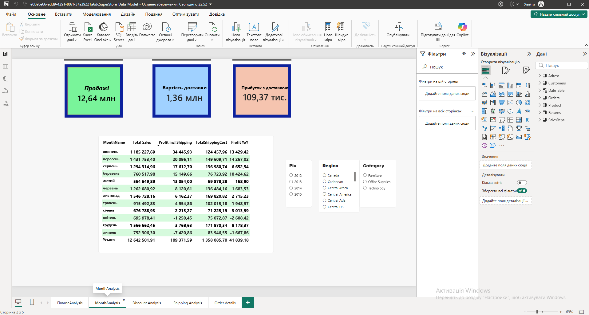
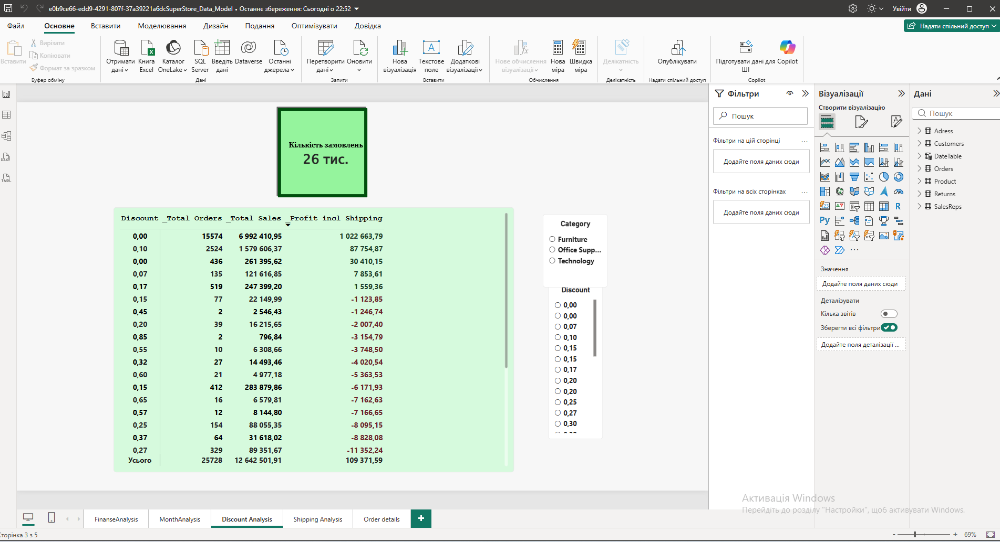
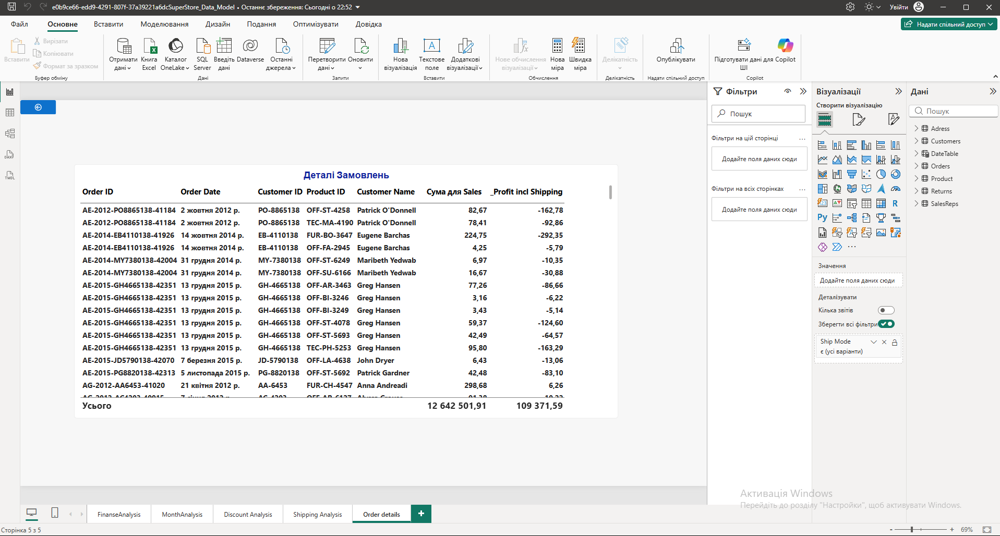
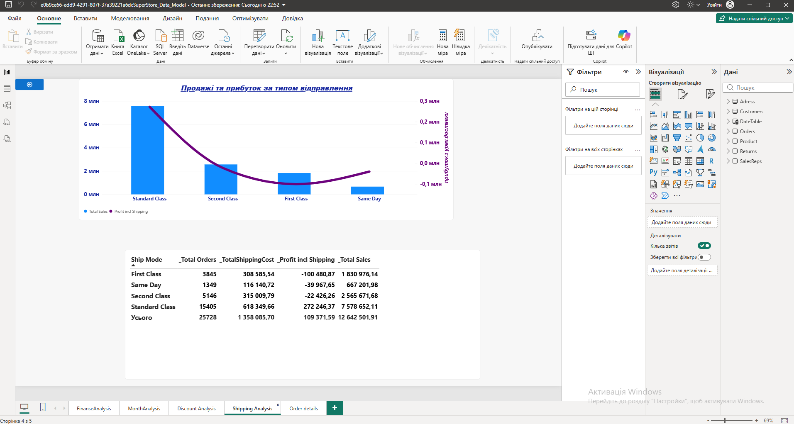

# Power BI Superstore Sales & Profitability Analysis

## 📊 Project Overview

This project uses Microsoft Power BI to analyze sales performance and profitability for a fictional retail superstore. The report explores financial results, monthly trends, discount impact, order details, and shipping performance.

The objective is to identify patterns in sales and profit, understand how discounts affect profitability, and provide an interactive view of business performance.

## 🎯 Business Objectives

- Monitor sales, profit, and shipping costs.
- Analyze monthly sales and profitability trends.
- Evaluate the relationship between discounts and profit.
- Compare performance across products, categories, and regions.
- Explore order-level details and shipping methods.
- Support data-driven business decisions through interactive reporting.

## 🛠️ Tools & Technologies

- **Microsoft Power BI Desktop** — dashboard development and visualization
- **DAX (Data Analysis Expressions)** — business measures and calculations
- **Data Modeling** — organizing data for analytical reporting
- **Power Query** — data preparation, where applicable
- **Interactive Visualizations** — charts, tables, KPI cards, and filters

## 📈 Report Pages

### 1. Financial Analysis

Provides an overview of financial performance, including sales and profitability metrics.

### 2. Monthly Analysis

Explores changes in sales and profit over time to help identify monthly trends.

### 3. Discount Analysis

Examines discount levels and their relationship with sales, order volume, and profitability.

### 4. Order Details

Provides a detailed view of individual orders and their associated business metrics.

### 5. Shipping Analysis

Explores shipping-related information and delivery costs to support operational analysis.

## 💡 Key Analytical Questions

- How do sales and profit change over time?
- Which products, categories, and regions contribute to business performance?
- How do different discount levels relate to profitability?
- What patterns can be identified in order details?
- How do shipping costs and shipping methods relate to overall performance?

## 🗂️ Dataset

The project uses the Superstore dataset, containing order, customer, product, sales, discount, profit, and shipping information.

**Dataset source:** [Superstore Dataset on Kaggle](https://www.kaggle.com/datasets/vivek468/superstore-dataset-final)

The source dataset is also included in this repository as `superstore_dataset.xlsx`.

The dataset is commonly used for educational and portfolio analysis. It represents sample retail data rather than verified financial records from a real company.

## 📁 Project Files

- **Power BI report (`.pbix`)** — the complete report and data model.
- **`superstore_dataset.xlsx`** — source data used for the analysis.
- **`FinanceAnalysis.png`** — financial analysis page.
- **`MonthAnalysis.png`** — monthly analysis page.
- **`DiscountAnalysis.png`** — discount analysis page.
- **`OrserDetails.png`** — order details page.
- **`ShippingAnalysis.png`** — shipping analysis page.

## 🚀 How to Explore the Project

1. Download the `.pbix` file from this repository.
2. Open it in Microsoft Power BI Desktop.
3. If prompted, update the data source path to the included Excel file.
4. Explore the report pages, visuals, and available filters.

## 📝 Notes

This project is part of my data analytics portfolio. The report is intended to demonstrate skills in business intelligence, data visualization, sales analysis, and profitability analysis.

The findings depend on the included sample dataset and the measures implemented in the Power BI report.

## 👩‍💻 Author

**Elena**  
Data Analytics Portfolio

